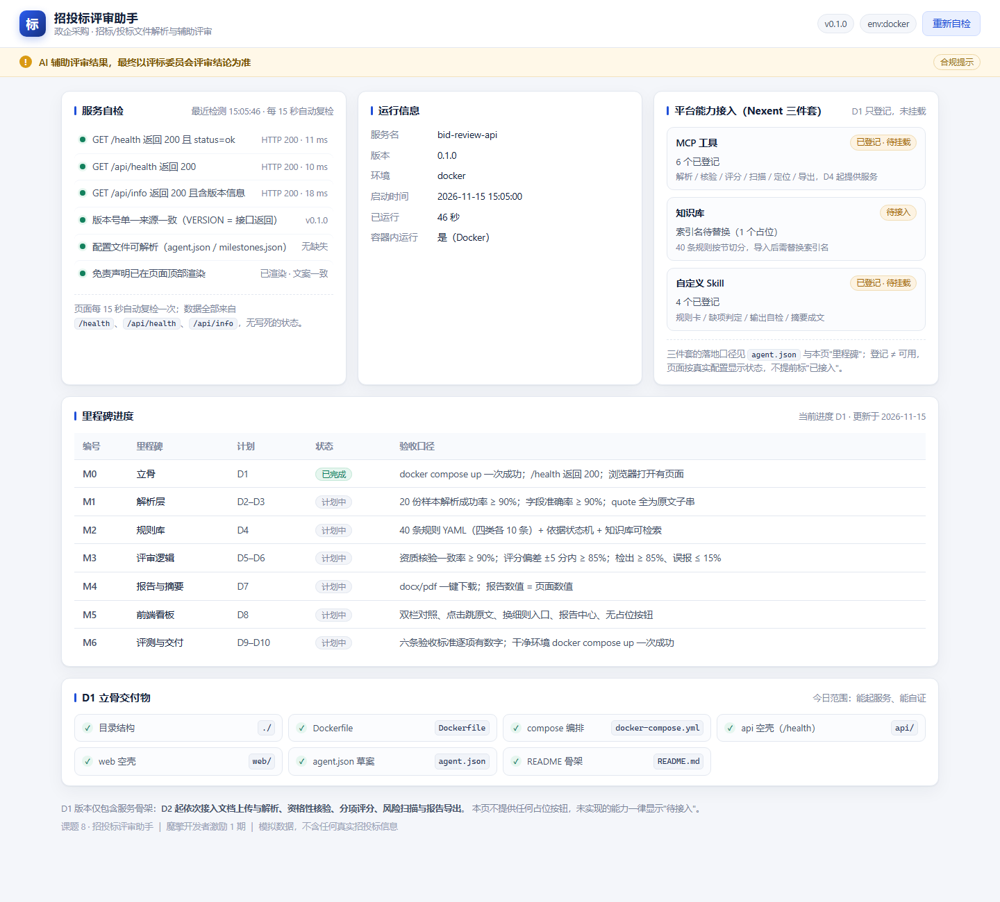

# 课题 8 · 招投标评审助手 —— D1 交接文档

| 项 | 内容 |
| --- | --- |
| 课题 | 8 · 招投标评审助手（政企采购 · 中级 ¥6,000） |
| 阶段 | **D1 立骨**（对应实施手册 §3.4.1 ①、§3.4.2 第一行） |
| 版本 | v0.1.0 |
| 日期 | 2026-11-15 |
| 目录 | `行业智能体/政务/招投标评审助手/` |
| 结论 | **D1 验收通过**：干净目录一次起服务成功、`/health` 返回 200、浏览器打开有页面 |
| 证据 | `docs/D1-自测记录.md`（原始命令与输出）、`docs/screenshots/D1-首页.png` |

---

## 一、一句话结论

D1 要的不是功能，是**"这条路能走通"**：一条命令起服务、一个探针能判活、一个页面能自证。
现在这三件事都成立了，并且**所有"没做"的能力在页面上显式显示"待接入"**——不摆假按钮、不提前标"已接入"，这是后面 9 天不返工的前提。

---

## 二、D1 验收对照

| 手册要求 | 实际交付 | 自测证据 | 结论 |
| --- | --- | --- | :-: |
| 目录结构 | 14 个目录 + 40 个文件，与手册 §3.2 对齐（`skills/` `mcps/` `knowledge/` `data/` `docs/` `tools/` 已占位并写明落地计划） | 见 §三 | ✅ |
| `Dockerfile` | `python:3.11-slim` + 依赖层分离 + 标准库 HEALTHCHECK + `BASE_IMAGE` 可覆盖 | 构建 50s 一次成功 | ✅ |
| `docker-compose.yml` | 显式项目名 `bid-review`（中文目录名会导致 Compose 项目名非法）、`HOST_PORT` 可覆盖、`./data` 持久化、`host.docker.internal` 映射 | `docker compose ps` → healthy | ✅ |
| `api` 空壳（`/health`） | `GET /health`、`GET /api/health`（含 8 项能力开关）、`GET /api/info`、`/api/docs` | `curl /health` → `HTTP 200` | ✅ |
| `web` 空壳 | 状态页：服务自检 6 项（全部真实请求）、运行信息、三件套接入状态、里程碑 M0–M6、D1 交付清单、顶部常驻免责声明 | 浏览器打开有页面，自检全绿 | ✅ |
| `agent.json` 草案 | MCP 6 工具 + 4 Skill + 知识库检索 + `temperature=0` + 校验/终局双开关；`prompt` 与 `prompt.md` 逐字一致 | `agent_config.py check` → 0 ERROR | ✅ |
| `README` 骨架 | 交付物索引、能力对照、接口一览、自测命令、合规声明、已知限制 | — | ✅ |
| 验收：干净目录一次起服务成功 | 删镜像重建后 `docker compose up -d` 直接 healthy，`restarts=0` | `docker inspect` → `healthy` | ✅ |
| 验收：`/health` 返回 200 | — | `HTTP 200` | ✅ |
| 验收：浏览器打开有页面 | 截图 1440×1300 | `D1-首页.png` | ✅ |

**当晚自测汇总**：冒烟 7/7 通过 · 接口单测 7 passed · 配置校验 0 ERROR/2 WARN（WARN 为必须留空的占位项）。

---

## 三、交付物清单

### 3.1 代码与配置

| 文件 | 行数 | 作用 |
| --- | --: | --- |
| `api/main.py` | 101 | 应用入口：CORS、安全头中间件、路由挂载、静态托管、东八区日志 |
| `api/config.py` | 71 | 路径 / 环境变量 / 版本号 / 免责声明的**唯一出口** |
| `api/routes/health.py` | 58 | `/health`（探针）与 `/api/health`（8 项能力开关） |
| `api/routes/meta.py` | 80 | `/api/info`：读 `agent.json` + 里程碑，返回页面所需一切 |
| `web/index.html` | 149 | 状态页结构（顶栏 / 免责条 / 自检 / 运行信息 / 三件套 / 里程碑 / D1 清单） |
| `web/style.css` | 385 | 自包含样式，无外链字体与 CDN，含响应式与打印样式 |
| `web/app.js` | 279 | 真实请求渲染、6 项自检、15s 轮询、切页复检 |
| `Dockerfile` | 41 | 依赖层缓存、非 root 说明、`BASE_IMAGE` 可覆盖 |
| `docker-compose.yml` | 33 | 一键起服务（端口/镜像源可覆盖） |
| `agent.json` | 99 | Nexent 导入配置（草案，占位项已在 README 标红） |
| `prompt.md` | 76 | 系统提示词 v0.1：角色 / 6 条边界 / 7 步流程 / 输出 JSON / 免责 |
| `data/meta/milestones.json` | 65 | 里程碑与 D1 清单的**唯一来源**，页面与文档同源 |

### 3.2 工具与测试

| 文件 | 作用 | 当前结果 |
| --- | --- | --- |
| `tools/agent_config.py` | `sync`：prompt.md → agent.json（单向写入）；`check`：12 项校验 | 0 ERROR |
| `tools/smoke_test.py` | 7 项验收，仅用标准库，CI 可跑 | 7/7 通过 |
| `tests/test_health.py` | 7 条接口单测（FastAPI TestClient） | 7 passed |
| `tests/conftest.py` | 让 `pytest` 在项目根直接跑通 | — |

### 3.3 文档

| 文件 | 内容 |
| --- | --- |
| `README.md` | 交付物索引（8 项打勾表）、平台能力对照、接口一览、自测命令、合规与限制 |
| `DEPLOY.md` | 环境要求、一键部署、配置项、7 类常见问题、干净环境复现清单 |
| `docs/D1-交接文档.md` | 本文件 |
| `docs/D1-自测记录.md` | 原始命令与输出（构建 / 起服务 / 探针 / 页面 / 冒烟 / 单测 / 配置校验 / 偏差） |
| `docs/screenshots/D1-首页.png` | 首页实拍 |
| `CHANGELOG.md` | v0.1.0 变更项 |
| `mcps/` `skills/` `knowledge/` `data/` | 各自的 README：写清"放什么、按什么规范、D 几落地" |

---

## 四、五分钟跑起来

```bash
cd "行业智能体/政务/招投标评审助手"

# 1) 起服务（首次构建约 1–3 分钟；依赖装在镜像里，不污染宿主）
docker compose up -d --build

# 2) 判活
docker compose ps                     # 期望 Up ... (healthy)
curl http://127.0.0.1:8080/health     # 期望 {"status":"ok",...} + HTTP 200

# 3) 看页面
#    浏览器打开 http://127.0.0.1:8080  → 服务自检 6 项全绿

# 4) 复跑验收
python tools/smoke_test.py            # 期望 7/7
python tools/agent_config.py check    # 期望 0 ERROR
```

本机 8080 被 32 题容器占用时：`HOST_PORT=18080 docker compose up -d`（本次自测即用 18080）。

---

## 五、六个设计决策（以及为什么这么选）

| # | 决策 | 理由 | 代价 / 何时改 |
| :-: | --- | --- | --- |
| 1 | **单容器**：前端静态文件由 FastAPI 托管，不额外起 nginx | D1 的验收是"一次起服务成功"，单容器只有一个构建、一个健康检查、一个端口，失败面最小；也省掉 nginx 镜像拉取 | D4 起会变成两容器（`api` + `mcp`），届时前端仍由 api 托管，不引入 nginx |
| 2 | **版本号只认 `VERSION` 文件** | README、镜像 tag、接口、页面四处都读它，避免"文档写 0.1、接口返回 0.2" | 加 `tools/bump_version.py` 时保持一致 |
| 3 | **里程碑与 D1 清单只认 `data/meta/milestones.json`** | 页面、README、交接文档三处同源，改一处即可；`/api/info` 直接吐给前端 | 里程碑推进时只改这个文件 |
| 4 | **`prompt.md` 是提示词唯一来源**，`agent.json.prompt` 由脚本单向写入 + 校验 | 提示词会在"给人读"和"给平台导入"两处存在，手改必然漂移；漂移后审核口径就说不清了 | 任何时候只改 `prompt.md`，再 `sync` |
| 5 | **页面不写死任何状态**，全部来自 `/health`、`/api/health`、`/api/info` | 评审最反感"页面写死已通过"；接口一变页面就变，才叫可演示 | 保持：新能力先加接口字段，再渲染 |
| 6 | **未实现的能力一律显示"待接入"**，不放灰按钮 | 赛题硬要求"不接受占位按钮"；D1 就没有上传入口，比放一个点了报错的按钮诚实 | D2 加上传，D5 加评审，逐个替换 |

**一条额外的防御性设计**：`/api/health` 里的 8 项能力开关（parse / qualification / scoring / risk_scan / report_export / mcp / knowledge_base / skills）现在全是 `false`。
D2 做完解析就把 `parse` 置 `true`——这样"哪天真做了"是接口可证的事实，不是口头声明。

---

## 六、接口契约

### 6.1 已实现（D1）

| 方法 | 路径 | 返回要点 |
| --- | --- | --- |
| GET | `/health` | `{status, service, version}`，供容器探针 |
| GET | `/api/health` | 追加 `env / started_at / uptime_seconds / python / in_container / capabilities(8) / disclaimer` |
| GET | `/api/info` | `{app, agent{name,max_steps,skills,mcp_tools,kb_index_ready,temperature}, milestones{items,d1_deliverables}, disclaimer, errors[]}` |
| GET | `/api/docs` | OpenAPI 交互文档（`/api/openapi.json` 为原始 schema） |

约定：
- 所有接口失败也返回 JSON，不吐 HTML 错误页；
- `errors[]` 非空表示配置缺失（`agent.json` / `milestones.json`），页面会显示"配置未就绪"，而不是静默 500；
- 响应统一带 `X-Content-Type-Options: nosniff`、`X-Frame-Options: SAMEORIGIN`。

### 6.2 D2 起新增（契约先定，避免返工）

```text
POST /api/upload            multipart(file) → {doc_id, file_name, ext, pages, parse_status, degraded[]}
GET  /api/doc/{doc_id}      → {doc_id, full_text, page_offsets[{page,start,end}], fields[], clauses[]}
POST /api/review            {doc_id, profile_id} → {review_id, status, ...}
GET  /api/review/{id}       → 核验 / 评分 / 风险清单（每条带 page + quote + basis）
POST /api/report            {review_id, format: "docx"|"pdf"} → 文件流
```

字段结构（**溯源三元组的唯一形态**，D2 起所有输出都必须长这样）：

```json
{
  "name": "项目名称",
  "value": "示例市政务云平台采购项目",
  "page": 1,
  "char_start": 128,
  "char_end": 146,
  "quote": "示例市政务云平台采购项目"
}
```

硬约束（D2 校验脚本要卡死）：`full_text[char_start:char_end] == quote`，且 `page_offsets` 里该 `char_start` 落在 `page` 区间内。

---

## 七、给 D2 的输入（解析层怎么接进来）

**D2 目标**：docx / pdf 文本层 → 条款切分 → **页码 + 字符偏移映射** → 字段抽取（项目名/编号/采购人/投标人/报价/工期）。

1. **统一的文档模型**（先定这个，别先写解析器）：
   ```python
   Doc = {
     "doc_id": str, "full_text": str,
     "page_offsets": [{"page": 1, "start": 0, "end": 1832}, ...],   # 用二分查页
     "clauses": [{"clause_id": "C007", "page": 3, "char_start": …, "char_end": …, "text": …}],
     "parse_status": "ok|degraded|failed", "degraded": ["页 12 无文本层，待 OCR"]
   }
   ```
   **页码映射在解析时就建好**，D2 之后任何"按页溯源"都只查这张表——这也是手册反复强调"晚一天做就全部返工"的那块地基。
2. **解析器放哪**：`api/parsers/`（`docx.py` / `pdf.py` / `txt.py`），每个解析器只负责"文件字节 → Doc"，不碰字段抽取。
3. **字段抽取放哪**：`api/extract/fields.py`，输入 Doc、输出字段列表；每个字段必须带 `page/char_start/char_end/quote`，抽不到就返回 `null` 而不是猜。
4. **样本放哪**：`data/samples/`，命名 `bid-{序号}-v1.{ext}`；标注 `*.labels.json` 与被标注文件同名（`data/README.md` 已写死这个约定）。
5. **自测先写脚本再写功能**：`tools/validate_quotes.py`（遍历解析结果，断言 `quote` 是 `full_text` 子串且偏移与页码一致）。D2 验收就靠它，先写脚本能让字段抽取少走一半弯路。
6. **顺带要做的两件小事**：`/api/health` 把 `capabilities.parse` 置 `true`；`milestones.json` 把 M1 状态从 `planned` 改 `doing`。页面会自动跟着变（这是第 5、6 条决策的收益）。

---

## 八、风险与未决事项

| # | 事项 | 影响 | 建议动作 | 状态 |
| :-: | --- | --- | --- | :-: |
| 1 | `agent.json` 的 `index_names` 是占位（`REPLACE_ME-1-…`） | 导入平台后检索被权限过滤，依据全变"未检索到权威依据" | D4 建库后用平台生成的 `<序号>-<hash>` 替换，跑 `agent_config.py check --strict` | 待 D4 |
| 2 | `author` 是占位（`REPLACE_ME_ATOMGIT_ID`） | PR 署名不对 | 提交前改成 AtomGit ID | 待提交 |
| 3 | `mcp_url` 仍是本机地址 `127.0.0.1:8765` | 平台侧不可达 | D4 起改为 compose 服务名 `http://mcp:8765/sse`，README 说明部署时改平台可达地址 | 待 D4 |
| 4 | 领域归类："政企采购"在仓库里没有对应目录 | PR 可能被要求挪目录 | 已按手册建议暂放 `政务/`，在 Issue 里问一句 | **待确认** |
| 5 | 本机 8080 被 32 题容器占用 | 本机演示需换端口 | 用 `HOST_PORT`，不影响他人环境默认 8080 | 已处置 |
| 6 | docker.io 直连拉基础镜像极慢（~40 KB/s） | 他人首次构建可能卡住 | Dockerfile 已留 `BASE_IMAGE`；DEPLOY 写了两条解法（国内镜像源 / 本机 digest） | 已缓解 |
| 7 | OCR 版本未锁 | D3 扫描件解析可能不稳 | D3 先锁 `rapidocr-onnxruntime==1.2.3` 再调参，别边调边换版本 | 待 D3 |
| 8 | 本机已跑着 Nexent v2.8.0（`nexent-runtime` 等容器） | D4/D7 联调环境现成，但尚未验证版本兼容 | D4 先在平台里手工跑通一次 `parse_tender` 再进 compose | 待 D4 |
| 9 | 尚未接 CI | 通用要求"过仓库 CI" | D9 前把 `smoke_test.py` + `pytest` + `agent_config.py check` 串成一条命令（`tools/ci.sh` 或 PowerShell 版） | 待 D9 |

---

## 九、明日（D2）任务分解

| 时段 | 任务 | 产出 | 完成判据 |
| --- | --- | --- | --- |
| 上午 1（2h） | 定 `Doc` 模型 + `page_offsets` 构造 + `docx`/`pdf` 解析器 | `api/parsers/`、`api/docmodel.py` | 10 份样本能解析出 `full_text` 与页偏移，页数对得上 |
| 上午 2（1.5h） | 条款切分（按"第X条/第X章/一、二、"三类） | `api/parsers/clauses.py` | 切分后条款覆盖正文 ≥ 95%，无跨页断裂 |
| 下午 1（2h） | 字段抽取 + 溯源三元组 | `api/extract/fields.py` | 6 个关键字段在 10 份样本上抽准 ≥ 90% |
| 下午 2（1h） | `tools/validate_quotes.py` + 接到冒烟 | 校验脚本 | 全部 `quote` 为原文子串，偏移-页码一致 |
| 收工前（0.5h） | 更新能力开关、M1 状态、自测记录、commit | 代码 + 文档 | `smoke_test.py` 新增 1 项通过；commit 写清"怎么验的" |

**D2 检查点（当天不达标就降级）**：解析成功率 < 80% → 立刻换库交叉验证（`python-docx` / `pdfplumber` / `PyMuPDF` 三选二），先放弃复杂版式。

---

## 十、收工动作（可直接复制）

**commit message 模板**

```text
feat(d1): 立骨 — 可一键起服务的骨架 + 状态页 + agent.json 草案

- api: /health、/api/health（8 项能力开关）、/api/info；web 静态托管
- web: 状态页 6 项真实自检 + 里程碑 + 三件套接入状态；无占位按钮
- deploy: Dockerfile（BASE_IMAGE 可覆盖）/ compose（显式项目名、端口可覆盖）
- tools: agent_config（prompt 单向同步 + 12 项校验）、smoke_test（7 项冒烟）
- docs: D1 交接文档 + 自测记录 + 首页截图
验证：compose ps healthy；smoke 7/7；pytest 7 passed；agent_config 0 ERROR
```

**讨论帖 / PR 进度同步（一句话版）**

```text
【课题 8 · 招投标评审助手｜D1】已交付：docker compose 一键起服务（healthy）、/health 200、
状态页自检 6 项全绿、agent.json 草案（MCP 6 工具 + 4 Skill 登记）；自测 smoke 7/7、pytest 7 passed。
D2 起做 docx/pdf 解析 + 页码/字符偏移映射 + 字段抽取（quote 必须为原文子串）。
```

---

## 十一、附：首页截图



> 截图要点：顶部常驻免责声明；「服务自检」6 项全部来自真实接口；「平台能力接入」按 `agent.json` 真实配置显示"已登记·待挂载 / 待接入"，不提前标"已接入"；「里程碑」M0 已完成，M1–M6 计划中。
