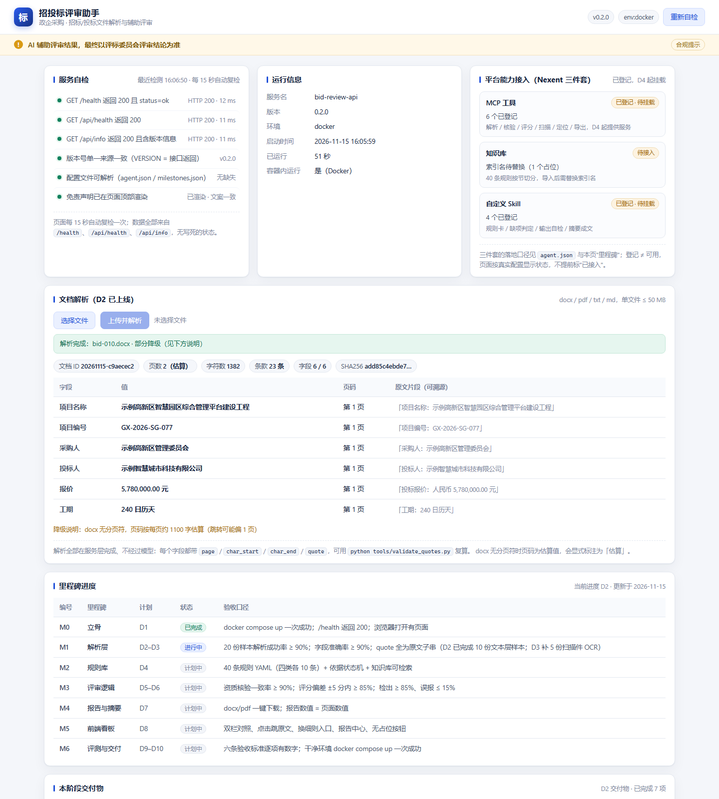

# 课题 8 · 招投标评审助手 —— D2 交接文档

| 项 | 内容 |
| --- | --- |
| 课题 | 8 · 招投标评审助手（政企采购 · 中级 ¥6,000） |
| 阶段 | **D2 解析层**（对应实施手册 §3.4.2 第二行、§4.1 溯源） |
| 版本 | v0.2.0 |
| 日期 | 2026-11-15 |
| 结论 | **D2 验收通过**：解析成功率 100%、字段准确率 100%、quote 与页码 100% 自洽 |
| 证据 | `docs/D2-自测记录.md`、`docs/screenshots/D2-解析面板.png`、`data/samples/manifest.json` |

---

## 一、一句话结论

D2 要解决的不是"能读出字"，而是**"读出来的每个字都能指回原文件的第几页、第几个字"**。
现在这条链是通的：上传 → 解析 → 页码表 → 条款切片 → 6 个字段（带 `page/quote`）→ 落盘 → 页面展示，
并且有一组**可复算**的脚本证明它不是"看着像"。

> 三个数字：**10/10** 解析成功、**58/58** 字段抽准、**58 字段 + 182 条款 0 处溯源不一致**。

---

## 二、D2 验收对照

| 手册要求（D2） | 实际交付 | 自测证据 | 结论 |
| --- | --- | --- | :-: |
| docx / pdf 文本层解析 | `api/parsers/docx_parser.py`（段落+表格，按正文顺序）、`pdf_parser.py`（逐页文本层） | 10 份样本解析成功率 100% | ✅ |
| 条款切分 | `api/parsers/clauses.py`：第X章 / 第X条 / 一、 / 1.1 / （一） 五类编号 | 10 份样本共 182 条条款 | ✅ |
| **页码 + 字符偏移映射** | `api/docmodel.py`：`pages[]` 区间表 + `page_of()` 二分查页 | 页码表连续覆盖全文，`validate_quotes.py` 0 不一致 | ✅ |
| 6 字段抽取（项目名/编号/采购人/投标人/报价/工期） | `api/extract/fields.py`，确定性规则 + 切片自校验 | 58/58 命中，边界样本 0 编造 | ✅ |
| 解析成功率 ≥ 90% | — | **100%（10/10）** | ✅ |
| 所有 `quote` 是原文子串 | 解析即建 `full_text`，字段 `quote` 从同一切片生成，落盘后二次校验 | **58 字段 / 0 不一致** | ✅ |

**当晚自测汇总**：`eval_parse.py` 100% / 100% / 0 多抽；`validate_quotes.py` 10 份文档、58 字段、182 条款全通过；
`smoke_test.py` **9/9**；`pytest` **15 passed**；`agent_config.py check` 0 ERROR。

---

## 三、交付物清单

### 3.1 代码

| 文件 | 行数 | 作用 |
| --- | --: | --- |
| `api/docmodel.py` | 163 | `Doc` / `PageSpan` / `Clause` / `SourceField`；页码二分查、越界保护、降级记录 |
| `api/store.py` | 97 | 原文与解析结果落盘、列表、`doc_id` 正则校验（挡路径穿越） |
| `api/parsers/docx_parser.py` | 100 | 段落与表格按正文顺序取出；分页符切页 / 无分页符估算并标降级 |
| `api/parsers/pdf_parser.py` | 68 | 逐页文本层；空页（扫描页）如实标页码，不猜内容 |
| `api/parsers/txt_parser.py` | 52 | 编码嗅探（utf-8 / gb18030 / utf-16）+ 换页符 / 字数分页 |
| `api/parsers/clauses.py` | 83 | 五类编号的条款切分，保留精确偏移 |
| `api/parsers/dispatch.py` | 55 | 按扩展名分发；失败降级为 `failed` + 原因，不抛 500 |
| `api/extract/fields.py` | 167 | 6 字段抽取；报价/工期单位归一；切片 ≠ quote 即丢弃 |
| `api/routes/docs.py` | 119 | 上传、列表、详情、取原文四个接口 |
| `web/app.js` | 438 | 解析面板、上传渲染、打开页面恢复最近一次结果 |
| `web/index.html` / `style.css` | 184 / 468 | 解析面板结构与样式（无占位按钮） |

### 3.2 数据与工具

| 文件 | 内容 |
| --- | --- |
| `data/samples/` | 10 份样本：docx×5、pdf×2、txt×3（含 GB18030、缺字段、￥无单位三种形态） |
| `data/samples/manifest.json` | 人工标准答案（58 个字段），评测的唯一口径 |
| `tools/make_samples.py` | 417 行，可重跑生成样本（docx→pdf 走 LibreOffice Kit） |
| `tools/eval_parse.py` | 126 行，复算解析成功率 / 字段准确率 / 多抽 |
| `tools/validate_quotes.py` | 117 行，校验 quote = 切片、页码 = 偏移、页码表连续覆盖全文 |
| `tools/smoke_test.py` | 新增第 8、9 项：真实 HTTP 上传 + 溯源复核 |

### 3.3 测试与文档

| 文件 | 内容 |
| --- | --- |
| `tests/test_parse.py` | 9 条：docx 六字段、pdf 页码 native、GB18030、缺字段不编造、￥与"个月"、条款切分、拒收非白名单、上传→查询→取原文 |
| `docs/D2-自测记录.md` | 原始命令与输出 |
| `docs/screenshots/D2-解析面板.png` | 页面实拍（含字段表与降级说明） |
| `README.md` / `CHANGELOG.md` | 进度、接口、目录、限制更新；0.2.0 变更项 |

---

## 四、五分钟验证

```bash
cd "行业智能体/政务/招投标评审助手"

# 1) 起服务（本机 8080 被占用时加 HOST_PORT=18080）
docker compose up -d --build
docker compose ps                                   # 期望 healthy

# 2) 端到端（上传 → 解析 → 溯源复核）
python tools/smoke_test.py                          # 期望 9/9

# 3) 指标复算（离线，不依赖服务）
python tools/eval_parse.py --strict                 # 期望 100% / 100% / 0 多抽
python tools/validate_quotes.py                     # 期望 0 处不一致

# 4) 重新生成样本（可选）
python tools/make_samples.py --no-pdf
```

页面：<http://127.0.0.1:8080> → 「文档解析（D2 已上线）」→ 选择 `data/samples/bid-001.docx` → 上传并解析。

---

## 五、六个设计决策

| # | 决策 | 理由 | 代价 / 何时改 |
| :-: | --- | --- | --- |
| 1 | **先定 `Doc` 模型，再写解析器** | 页码表是所有"溯源"的地基；先写解析器一定会返工（手册反复强调） | 模型变更要同步改 3 个解析器 + 校验脚本，所以 D2 一次定死 |
| 2 | **页码三分：`native` / `estimated` / `single`** | pdf 与带分页符的 docx 页码精确；docx 无分页符只能估算；txt 可能只有一页。**不假装精确**，`page_source` 直接给前端判断是否显示"估算" | 想更精确要接排版引擎（Word 自动化），本项目不做 |
| 3 | **字段抽取不用模型** | 正则 + 切片自校验 → 同一输入永远同一结果；模型改写措辞会让 `quote` 失效 | 后续若加"表格内字段"，仍用规则 + 位置，不改成模型 |
| 4 | **解析失败也是结果** | `parse_status=failed` + `degraded` 原因，页面能说清"为什么没解析出来"；500 对用户没有任何信息量 | 保持 |
| 5 | **`clause_id` 只由切分器分配** | 让模型"数第几条"是溯源事故的主要来源；下游引用一律用 `clause_id` | 保持 |
| 6 | **结果落盘 JSON** | 刷新页面 / 重启容器后还能看到上次对象；报告与页面读同一份数据；评测可离线复算 | D7 生成报告时直接读这份 JSON |

**一条防御性设计**：`SourceField` 在写入前做一次 `text[start:end] == quote` 自校验，不成立就**丢弃该字段**。
宁可少抽一个字段，也不产生一条无法溯源的结论——这是"溯源准确率 100%"这条硬指标的地基。

---

## 六、数据结构契约（D3 起不得破坏）

```json
{
  "doc_id": "20261115-a2eeb894",
  "file_name": "bid-001.docx",
  "page_source": "estimated",
  "parse_status": "degraded",
  "page_count": 2,
  "char_count": 1382,
  "pages": [{ "page": 1, "start": 0, "end": 1100 }, { "page": 2, "start": 1100, "end": 1382 }],
  "fields": [
    {
      "name": "报价",
      "value": "1,286,000.00 元",
      "page": 1,
      "char_start": 268,
      "char_end": 302,
      "quote": "投标报价：人民币 1,286,000.00 元"
    }
  ],
  "clauses": [
    { "clause_id": "C001", "label": "第一章", "title": "投标函", "page": 1,
      "char_start": 120, "char_end": 380, "text": "第一章 投标函\n一、投标承诺…" }
  ],
  "degraded": ["docx 无分页符，页码按每页约 1100 字估算（跳转可能偏 1 页）"]
}
```

两条硬断言（`tools/validate_quotes.py` 会逐条验）：

1. `full_text[char_start:char_end] == quote`
2. `pages` 中该 `char_start` 落在的区间，其 `page` 等于字段声明的 `page`

---

## 七、给 D3 的输入（OCR 怎么接进来）

1. **接入点只有两个，不要动其他地方**：
   - `pdf_parser`：某页 `extract_text()` 为空 → 该页交给 OCR，得到文本后替换该页 chunk；
   - `docx_parser`：正文里没有文本、只有图片（`inline_shapes` 多但段落空）→ 整份文档走 OCR 兜底。
2. **输出仍然是 `Doc`**：OCR 结果必须经过同一套 `build_pages` 建页码表，`page_source` 保持 `native`
   （因为扫描件本来就有真实页），并把该页的降级说明从 `degraded` 里移除。
3. **5 份扫描件怎么造**（写进 `make_samples.py` 的 `--scan` 分支即可）：
   把现有 docx 用 LibreOffice 转 pdf → 再用 `pdftoppm`/Pillow 渲染成图片 → 图片重新打包成无文本层 pdf。
   标准答案沿用原样本的 `manifest.json` 条目，**不要另写一套**，否则两套口径没法比。
4. **验收口径**：D3 只要求"5 份扫描件全部跑通 + 边界样本不崩"；
   `eval_parse.py` 的解析成功率仍按"非 failed"计，OCR 后的字段准确率单独一列统计（写进测试报告）。
5. **两个坑**：
   - OCR 必须锁版本（`rapidocr-onnxruntime==1.2.3`），否则同一图片两次识别结果可能不同，"重复 3 次一致"会挂；
   - OCR 给的是**行级坐标**，转字符偏移时要按"行文本 + 换行符"累加，不能按像素比例拍脑袋。

---

## 八、风险与未决事项

| # | 事项 | 影响 | 建议动作 | 状态 |
| :-: | --- | --- | --- | :-: |
| 1 | docx 无分页符时页码为估算（1100 字/页） | 跳转可能偏 1 页，评审抽查会看出来 | 已用 `page_source=estimated` + 页面标注"估算"；D3 可选用"按段落数估算"提高准确度 | 已缓解 |
| 2 | 字段只认"标签：值"同行；表格单元格里的字段没抽 | 真实标书大量字段在表格里 | D3/D9 增加"表格行 → 字段"的抽取路径 | 待 D3 |
| 3 | 扫描件目前只标记降级、不猜内容 | 5 份扫描件样本会判 failed | D3 接 OCR | 待 D3 |
| 4 | pdf 表格文本取出来是行序，可能字段跨行 | 报价/工期在表格里时抽不到 | D3 补 pdfplumber 提取表格（或 OCR 后按行处理） | 待 D3 |
| 5 | `data/parsed/` 未清理机制，长期跑会堆积 | 演示环境磁盘增长 | D9 加 `--keep N` 清理，或按日期分目录 | 待 D9 |
| 6 | 大文件（>50MB）直接 413 | 扫描件 pdf 容易超 | 已在 .env 暴露 `MAX_UPLOAD_MB`；D3 测一份大扫描件确认 | 已缓解 |

---

## 九、明日（D3）任务分解

| 时段 | 任务 | 产出 | 完成判据 |
| --- | --- | --- | --- |
| 上午 1（2h） | 造 5 份扫描件样本（docx→pdf→图片→无文本层 pdf） | `data/samples/scan-*.pdf` + manifest 条目 | 5 份 pdf 文本层为空，`/api/upload` 判 `failed` 并给出降级原因 |
| 上午 2（1.5h） | 接 OCR：锁 `rapidocr-onnxruntime==1.2.3`，pdf 空页走 OCR | `api/parsers/ocr.py` + 改动 `pdf_parser` | 5 份扫描件全部解析出文本与字段 |
| 下午 1（1.5h） | 坐标 → 字符偏移（行级累加），把 OCR 页并入页码表 | 同上 | 扫描件字段 `quote` 仍 100% 落在 `full_text` 内 |
| 下午 2（1h） | 边界样本：低质量 / 旋转 / 空白页，显式降级 | `data/samples/boundary/` | 不崩、不编造，降级原因可读 |
| 收工前（0.5h） | 更新 `eval_parse.py`（扫描件单列）、自测记录、commit | 代码 + 文档 | `eval_parse.py` 输出扫描件与文本层两组数字 |

**D3 检查点**：5 份扫描件解析成功率 < 80% → 先降级为"标记未解析 + 提示人工"，保住"不编造"这条底线，再调 OCR。

---

## 十、收工动作（可直接复制）

**commit message**

```text
feat(d2): 解析层 — docx/pdf/txt + 页码映射 + 6 字段抽取（含溯源）

- docmodel: Doc/PageSpan/Clause/SourceField，page_of 二分查页
- parsers: docx（段落+表格、分页符/估算）、pdf（逐页文本层）、txt（编码嗅探）
- extract: 6 字段确定性抽取，切片自校验，抽不到不猜
- api: /api/upload /api/documents /api/doc/{id} /api/doc/{id}/raw，结果落盘
- data: 10 份样本 + manifest（58 字段标准答案）
- tools: make_samples / eval_parse / validate_quotes；smoke 增 2 项
- web: 解析面板（选择文件→解析→字段+原文+降级说明）
验证：解析 10/10=100%、字段 58/58=100%、58 字段/182 条款 0 处溯源不一致；smoke 9/9；pytest 15 passed
```

**讨论帖 / PR 进度同步**

```text
【课题 8 · 招投标评审助手｜D2】解析层完成：docx/pdf/txt → 页码与字符偏移映射 → 条款切分 → 6 字段抽取（带 page/quote）。
自测：10 份样本解析成功率 100%、字段准确率 100%，58 个字段 + 182 条条款的溯源 0 处不一致；smoke 9/9、pytest 15 passed。
页面已可上传文件看字段与原文片段。D3 做扫描件 OCR 与边界样本。
```

---

## 十一、附：页面截图



> 截图要点：上传区可选文件（无占位按钮）；解析完成后显示文档 ID、页数（docx 标"估算"）、字符数、条款数、字段命中数；
> 字段表逐行给出**值 / 页码 / 原文片段**；底部显式写出降级原因（"docx 无分页符，页码按每页约 1100 字估算"）。
