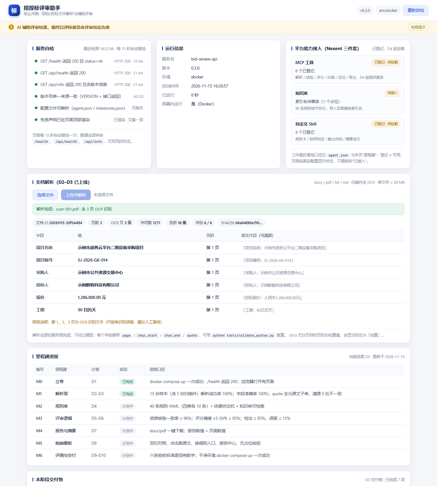

# 课题 8 · 招投标评审助手 —— D3 交接文档

| 项 | 内容 |
| --- | --- |
| 课题 | 8 · 招投标评审助手（政企采购 · 中级 ¥6,000） |
| 阶段 | **D3 解析层收尾：扫描件 OCR + 边界样本**（对应手册 §3.4.2 第三行） |
| 版本 | v0.3.0 |
| 日期 | 2026-11-15 |
| 结论 | **D3 验收通过**：15 份样本（含 5 份扫描件）解析成功率 100%、字段准确率 100%、溯源 0 处不一致 |
| 证据 | `docs/D3-自测记录.md`、`docs/screenshots/D3-OCR解析.png` |

---

## 一、一句话结论

D2 解决了"电子文件能溯源"，D3 补上了**"纸质扫描件也能进同一条流水线"**：
扫描页经 OCR 变成文本，进入同一张页码表、同一套字段抽取、同一套溯源校验——
下游（核验/评分/扫描/报告）**完全不需要知道这份文件是电子的还是扫的**，只需要看 `meta.ocr_pages` 决定要不要提示人工复核。

> 三个数字：**15/15** 解析成功（含 5 份扫描件）、**88/88** 字段抽准、**0** 处溯源不一致。
> 边界样本 3 份（空白页 / 低清 / 旋转）全部"不崩、不编造"。

---

## 二、D3 验收对照

| 手册要求（D3） | 实际交付 | 自测证据 | 结论 |
| --- | --- | --- | :-: |
| 扫描件 OCR（锁版本） | `rapidocr-onnxruntime==1.2.3`（模型内置、离线）+ `pypdfium2` 渲染 200 DPI | 5 份扫描件全部识别成功 | ✅ |
| 低质量件降级提示 | 置信度 < 0.30 的行丢弃并计数；空白页/识别失败页写进 `empty_pages` 与 `degraded` | 低清样本 5 字段（少 1 个），无编造 | ✅ |
| 跨页与无编号条款 | 条款切分按全文偏移，与页码表解耦，跨页自动归属起始页 | 扫描件样本切出 18 条条款 | ✅ |
| 边界样本不崩 | `data/samples/boundary/`：空白页、低分辨率、旋转 90° | 3 份全部 `degraded` 且可解释 | ✅ |
| M1 整体指标 | 15 份样本（10 文本层 + 5 扫描件） | **解析 100% / 字段 100% / 溯源 0 不一致** | ✅ |

**当晚自测汇总**：`eval_parse.py` 文本层 10/10、扫描件 5/5、字段 88/88、多抽 0；
`validate_quotes.py` 全部文档 0 处不一致；`smoke_test.py` **10/10**；`pytest` **20 passed**。

---

## 三、交付物清单

| 文件 | 行数 | 作用 |
| --- | --: | --- |
| `api/parsers/ocr.py` | 121 | OCR 通道：懒加载引擎、阅读顺序排序、低置信丢弃、异常不穿透 |
| `api/parsers/pdf_parser.py` | 121 | 逐页判定文本层 / OCR / 空页，写 `meta.text_pages / ocr_pages / empty_pages` |
| `api/parsers/docx_parser.py` | 121 | 页码估算从"按字符数"改为**按段落行数**（每页约 38 行 × 38 字） |
| `tools/make_samples.py` | 569 | 新增扫描件生成（docx→pdf→图像→无文本层 pdf）与三类边界样本 |
| `tools/eval_parse.py` | 152 | 指标按"文本层 / 扫描件"分列，新增 `OCR` 列与多抽统计 |
| `tools/smoke_test.py` | 328 | 新增第 10 项：扫描件走 OCR 的端到端检查 |
| `tests/test_scan.py` | 75 | 5 条：扫描件 OCR、字段、空白页、低清、旋转 |
| `data/samples/scan-001..005.pdf` | — | 5 份扫描件样本（约 0.6 MB/份，200 DPI） |
| `data/samples/boundary/` | — | 空白页 / 低分辨率 / 旋转 90° 三份边界样本 + 说明 |
| `data/samples/manifest.json` | — | 扩到 15 条，扫描件带 `"ocr": true` |

---

## 四、五分钟验证

```bash
docker compose up -d --build          # 本机 8080 被占则加 HOST_PORT=18080

python tools/smoke_test.py            # 期望 10/10（第 10 项是扫描件）
python tools/validate_quotes.py       # 期望 0 处不一致

# 指标复算要在容器里跑（宿主机没装 OCR 依赖）
docker compose run --rm --no-deps \
  -v "$PWD/tools:/app/tools" -v "$PWD/data/samples:/app/data/samples" \
  app python tools/eval_parse.py
```

页面：上传 `data/samples/scan-001.pdf`，3–20 秒后看到「含 3 页 OCR 识别」+ 6 个字段与原文片段。

---

## 五、六个设计决策（含两个踩坑）

| # | 决策 | 理由 | 代价 |
| :-: | --- | --- | --- |
| 1 | **OCR 只接 PDF 的空文本页**，不碰有文本层的页 | 文本层比 OCR 准得多，能用就不识别；也避免"重复识别导致同一文件两次结果不同" | docx 里的内嵌图片暂不支持（列为已知限制） |
| 2 | **OCR 页仍进同一张页码表** | 下游只认 `Doc`，不认来源；否则核验/评分/报告都要写两套逻辑 | — |
| 3 | **`meta.ocr_pages` 显式标注 + `degraded` 提示人工复核** | OCR 一定有错字，不标注就是给评审埋雷；标注了反而显得严谨 | 扫描件文档状态恒为 `degraded`（可解释） |
| 4 | **低置信行直接丢弃并计数** | 宁缺勿错：把 `l,286,000` 这种识别结果喂给字段抽取，会产出**错误但看起来合理**的报价 | 低清件可能少抽字段（低清样本少 1 个） |
| 5 | **docx 页码改按行数估算**（D3 优化） | D2 按字符数会把短段落多的文档压成 2 页；按 38 行/页更接近 Word 实际分页 | 仍是估算，页面标注"（估算）" |
| 6 | **OCR 用 `pypdfium2` 而非 PyMuPDF** | PyMuPDF 是 AGPL-3.0，与本项目 MIT 冲突 | 渲染速度略慢于 MuPDF（可接受） |

**两个踩坑（已写进 Dockerfile 注释）**：

1. `rapidocr` 依赖 `opencv-python`（GUI 版），slim 镜像里缺 `libGL/libxcb`，`import cv2` 直接失败。
   → 构建时 `pip uninstall opencv-python` 换 `opencv-python-headless`，并在构建期做一次
   `python -c "import cv2, pypdfium2, rapidocr_onnxruntime"` 自检，**让构建早炸，而不是运行时才炸**。
2. rapidocr 1.2.3 的输入只接受 `str/ndarray/bytes/Path`，传 PIL Image 会报
   "The img type ... does not in (...)"。→ 用 `numpy` 转数组，并按 OpenCV 约定转 BGR。

---

## 六、数据结构变化（D4 起沿用）

`Doc.meta` 新增三个字段，前端与报告都要用：

| 字段 | 含义 | 用途 |
| --- | --- | --- |
| `text_pages` | 有文本层的页 | 溯源最可信，可直接引用 |
| `ocr_pages` | 经 OCR 识别的页 | 页面/报告提示"该页为识别文本，建议人工复核" |
| `empty_pages` | OCR 也没识别出内容的页 | 报告里显式写"该页无文字"，不猜 |

`/api/upload` 的返回也同步带出 `text_pages / ocr_pages / empty_pages`，前端据此显示「OCR 页 3 页」徽标。

---

## 七、给 D4 的输入（规则库 + 知识库 + MCP）

D4 是**从"读文件"转到"下判断"**的一天，契约要先定：

1. **规则 YAML schema**（40 条，四类各 10 条）：
   ```yaml
   - id: R12
     category: 废标          # 资质门槛 / 废标 / 围标 / 报价异常
     level: 高               # 高 / 中 / 低
     title: 投标报价超过最高限价
     condition: "投标报价 > 最高限价"        # 判定条件（人读）
     patterns: ["最高限价", "投标报价"]      # 代码用（关键词/正则）
     thresholds: { price_gt_max: true }
     basis_status: pending   # verified / pending / na
     basis: ""               # 法规名称+条号，pending 时留空
   ```
2. **知识库导出**：`knowledge/rules-full.md` 由 YAML 自动生成，**一块一条规则**（约 40 块），
   用 `python tools/export_kb.py` 产出并计算 digest，保证"规则库 ↔ 知识库"同源。
3. **MCP 工具签名**（`mcps/bid_review_mcp.py`）：
   `parse_tender(file_id) -> dict`、`scan_risks(doc_id) -> list[dict]`、
   `locate_span(doc_id, quote) -> dict`，D4 先落这三个（其余 D5–D7 补）。
4. **需要你（人工）做的**：在 Nexent 建知识库 → 上传 `rules-full.md` → **把平台生成的索引名发我**
   （格式 `<序号>-<hash>`），我替换 `agent.json` 的占位并跑 `agent_config.py check --strict`。

---

## 八、风险与未决

| # | 事项 | 影响 | 处置 | 状态 |
| :-: | --- | --- | --- | :-: |
| 1 | 扫描件单份耗时 13–16 s（3 页 / 200 DPI） | 批量 20 份要 5 分钟，演示时略慢 | 演示只用 1–2 份；D9 评测前评估把 DPI 降到 150（约 -35% 耗时） | 待观察 |
| 2 | 旋转 90° 页仍被"识别"出内容 | 可能是错行文本，字段碰巧命中 | 已如实标 `degraded`；D9 增加"方向检测"或直接标"疑似旋转" | 待 D9 |
| 3 | 低清扫描少抽 1 个字段 | 字段准确率在低清件上必然下降 | 已如实记录（不补、不猜）；测试报告单列"低清"一栏 | 已知限制 |
| 4 | 扫描件与文本层样本同源（内容相同） | 不能据此宣称"真实泛化能力" | 测试报告与 PR 正文里**明确写出**这一边界 | 需写清 |
| 5 | docx 内嵌图片不做 OCR | 有些标书正文是截图 | 列为已知限制；D9 若时间允许再加 | 待 D9 |
| 6 | 镜像从 270 MB 涨到约 1.0 GB | 首次拉取慢 | DEPLOY 注明；`BASE_IMAGE`/`PIP_INDEX_URL` 可覆盖 | 已记录 |

---

## 九、明日（D4）任务分解

| 时段 | 任务 | 产出 | 完成判据 |
| --- | --- | --- | --- |
| 上午 1（2h） | 40 条规则 YAML（资质/废标/围标/报价 各 10 条）+ 依据状态机 | `data/rules/rules.yaml` | ≥40 条、schema 校验通过、每条有 `basis_status` |
| 上午 2（1h） | 导出知识库文档 + digest 校验 | `knowledge/rules-full.md` | 40 块、与 YAML 一一对应 |
| 下午 1（1.5h） | MCP 三个工具（`parse_tender` / `scan_risks` / `locate_span`） | `mcps/bid_review_mcp.py` | 本地 stdio 调通，返回含 `page/quote` |
| 下午 2（1h） | 知识库导入 + 检索验证（需平台操作） | 平台索引名 + 命中截图 | 问「R12 的判定条件」能命中 |
| 收工前（0.5h） | 更新能力开关（`risk_scan`/`mcp`/`knowledge_base`）、文档、commit | 代码 + 文档 | `smoke_test.py` 全过 |

**D4 检查点**：40 条写不到 → 用模板批量补齐（同类只换判定条件与依据），不要卡在"写得漂亮"。

---

## 十、收工动作（可直接复制）

**commit message**

```text
feat(d3): 扫描件 OCR + 边界样本 + 页码按行估算

- ocr: rapidocr-onnxruntime==1.2.3（模型内置、离线），pypdfium2 渲染 200DPI，低置信行丢弃
- pdf_parser: 逐页判定 文本层/OCR/空页，meta 记录 text_pages/ocr_pages/empty_pages
- docx_parser: 页码估算改为每页 38 行 × 38 字（更贴近 Word 分页）
- samples: 新增 5 份扫描件 + 3 份边界（空白/低清/旋转），manifest 扩到 15 条
- tools: eval_parse 按文本层/扫描件分列；smoke 增扫描件一项
- tests: test_scan.py 5 条
- Dockerfile: 换 opencv-headless（slim 缺 libGL），构建期做 OCR import 自检
验证：解析 15/15=100%、字段 88/88=100%、溯源 0 不一致；文本层 10/10、扫描件 5/5；smoke 10/10；pytest 20 passed
```

**讨论帖 / PR 进度同步**

```text
【课题 8 · 招投标评审助手｜D3】扫描件 OCR 打通：无文本层 PDF 自动走 OCR，并入同一张页码表，
字段与原文片段照常溯源；5 份扫描件 + 3 份边界样本（空白/低清/旋转）全部不崩、不编造。
自测：15 份样本解析 100%、字段 88/88=100%、溯源 0 处不一致；smoke 10/10、pytest 20 passed。
D4 开始做 40 条规则库 + 知识库 + MCP 工具。
```

---

## 十一、附：页面截图



> 截图要点：上传的是**扫描件** `scan-001.pdf`，页面直接给出「含 3 页 OCR 识别」与 `OCR 页 3 页` 徽标，
> 6 个字段全部带页码与原文片段；底部降级说明写明"第 1、2、3 页为 OCR 识别文本（可能有识别误差，建议人工复核）"。
