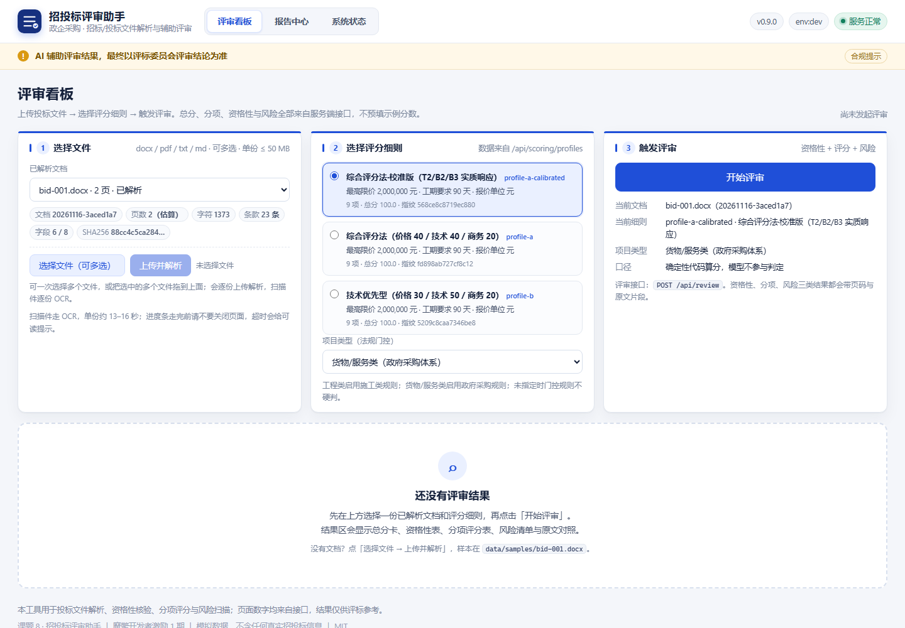
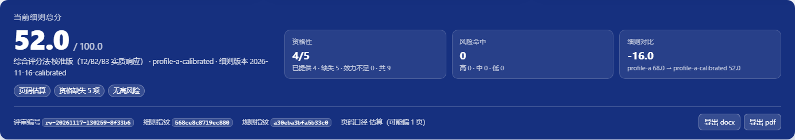
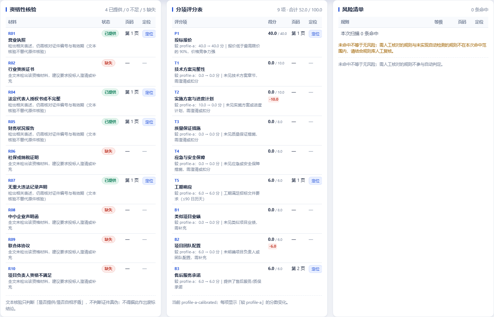
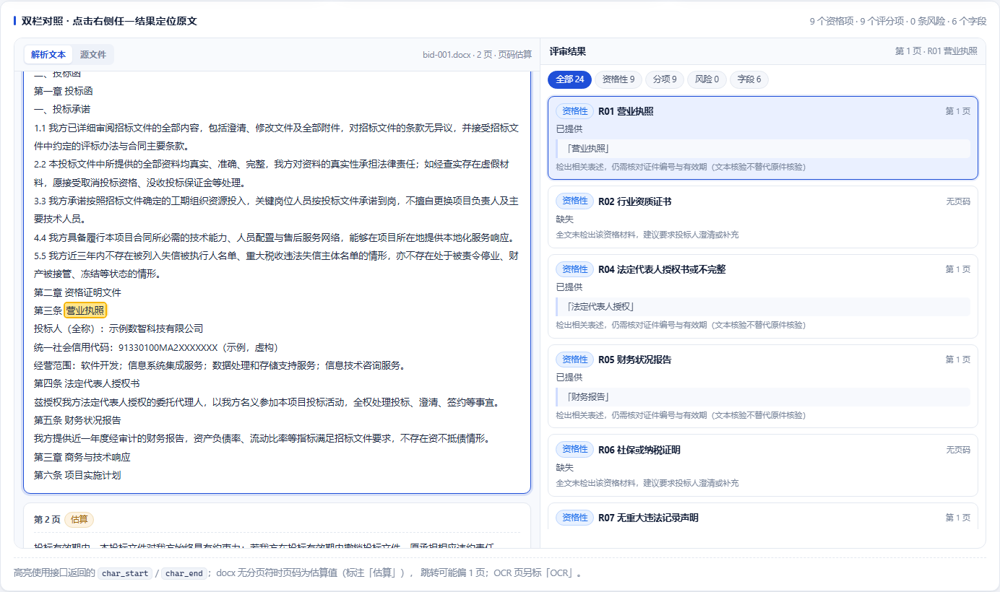
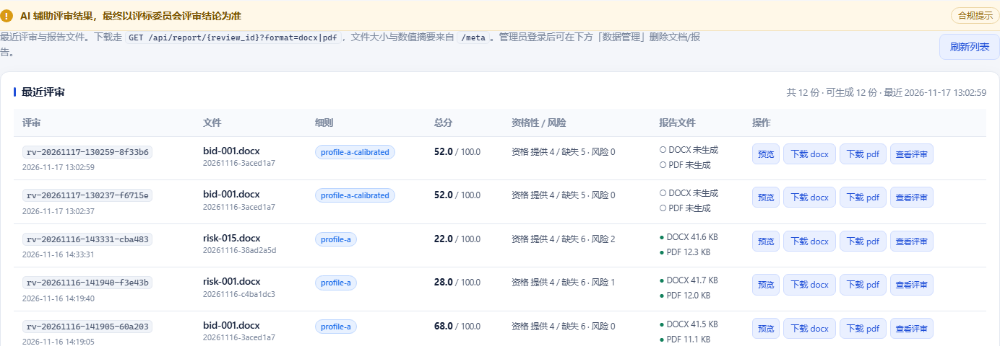

# 招投标评审助手 · 使用说明

> 对应开发阶段：M4 报告与摘要、M5 前端看板。
> 面向评标专家、采购经办人和投标文件初审人员。  
> **AI 辅助评审结果，最终以评标委员会评审结论为准。**

## 一、系统能做什么

招投标评审助手把一份投标文件变成一套可核对的评审结果：

| 功能 | 输入 | 输出 |
| --- | --- | --- |
| 文件解析 | docx / pdf / txt / md | 按页文本、页码、原文坐标、条款切分 |
| 8 字段抽取 | 已解析文档 | 项目名称、编号、采购人、投标人、报价、工期、资质清单、业绩清单 |
| 资格性核验 | 已解析文档 | R01–R10 逐项：已提供 / 缺失 / 效力不足，带页码与原文 |
| 分项评分 | 文档 + 评分细则 | 9 项得分、扣分理由、依据、页码 |
| 风险扫描 | 文档 + 项目类型 | 40 条规则中的自动项命中清单；人工项明确标注 |
| 双栏对照 | 评审结果 | 左侧原文、右侧结果，点击「定位」跳页高亮 |
| 报告导出 | 评审结果 | docx / pdf，九章结构，带页码、quote、依据三态 |
| 报告中心 | 历史评审 | 预览、下载 docx/pdf、查看原件、管理员数据管理 |

## 二、适用文件与边界

- 格式：`.docx`、`.pdf`、`.txt`、`.md`；
- 单文件 ≤ 50 MB；
- 扫描件走 OCR，单份 3 页约 13–16 秒；
- docx 无分页符时页码按行数估算，页面标「估算」，允许偏 1 页；
- **不做**：证件真伪鉴定、业绩真实性核验、工程清单计价、法律意见、中标/废标结论。

## 三、5 分钟上手

1. 打开 **http://127.0.0.1:18080/#review**；
2. 「选择文件」选一份，或一次选/拖入多份 →「上传并解析」；
3. 在「已解析文档」下拉框选择一份；
4. 评分细则默认 `profile-a-calibrated`（校准版）；项目类型选「工程类 / 货物服务类 / 未指定」；
5. 点「开始评审」；
6. 看「总分卡 + 资格性 + 分项 + 风险」；点「定位」回原文；
7. 「报告中心」预览、下载 docx/pdf，或点「查看原件」并排比对。

> 换一份文档或换一套细则，重新点「开始评审」即可；不会覆盖上一份结果。

## 四、评审看板

### 4.1 选择文件

- 「选择文件（可多选）」支持一次选多份；
- 上传后逐份解析，页面显示成功/失败汇总；
- 「已解析文档」下拉框的每一行显示：文件名、页数、解析状态；
- `degraded` 表示页码估算或 OCR，页面会注明，不是解析失败。

### 4.2 选择评分细则

| 细则 | 价格 | 技术 | 商务 | 用途 |
| --- | ---: | ---: | ---: | --- |
| `profile-a-calibrated` | 40 | 40 | 20 | **默认**；T2/B2/B3 要求实质响应 |
| `profile-a` | 40 | 40 | 20 | 旧基线，用于对照 |
| `profile-b` | 30 | 50 | 20 | 技术权重更高的项目 |

卡片上会显示最高限价、工期要求、9 项、总分 100、细则指纹。

### 4.3 项目类型门控

- **工程类**：启用施工类规则（如 R03 安全生产许可证）；
- **货物/服务类**：启用政府采购规则（如 R08 中小企业声明函）；
- **未指定**：按通用口径，报告提示“项目类型未指定，建议选择后复核”，不静默套用另一套法律体系。

### 4.4 开始评审

点「开始评审」后，接口 `POST /api/review` 返回：

- 总分、总分满分、资格性计数、风险计数；
- 资格性 10 项（按项目类型门控）；
- 分项 9 项；
- 风险命中；
- 评审编号、细则指纹、规则指纹、页码口径。

## 五、结果怎么读

### 5.1 总分卡

- 大号数字是当前细则总分；
- 「资格性 4/5」：已提供 4 项、共 5 项；缺失 5 项在表里逐项列出；
- 「风险命中」：高/中/低数量；
- 「细则对比」：与旧 `profile-a` 的分数差；
- 底部：评审编号、细则指纹、规则指纹、页码口径、导出按钮。

### 5.2 三张结果表

**资格性表**

- 状态：`已提供` / `缺失` / `效力不足`；
- 每项带页码与「定位」；
- 只判断“文本有没有写/是否自相矛盾”，不判断证件真伪。

**分项评分表**

- 每项显示得分/满分、页码、扣分理由；
- 换细则后显示「较 profile-a」的差值；
- 扣分理由与依据随行展示。

**风险表**

- 规则编号、等级、页码、定位；
- 未命中写“不等于无风险”；
- R25/R32/R33 需多家比价，单份不可判定，报告会写明“未参与判定”。

### 5.3 双栏对照

- 左侧「解析文本」/「源文件」；
- 右侧结果卡片，按资格性/分项/风险/字段筛选；
- 点「定位」跳转到对应页并高亮原文；
- 底部状态栏显示当前页、页码口径（精确/估算/OCR）。

### 5.4 报告中心

- 每行：评审编号、文件、细则、总分、资格性/风险计数、报告文件；
- 「预览」看摘要与报告；
- 「下载 docx」「下载 pdf」导出九章报告；
- 「查看评审」回到该次评审；
- 管理员登录后可在本页底部「数据管理」删除文档/评审/报告。

### 5.5 报告内容

九章：封面与文档信息 / 评审依据 / 项目与投标人 / 资格性 / 分项评分 / 风险清单 / 合同摘要 / 结论与建议 / 免责声明。

- 每条结论带页码与 quote；
- 依据三态：`verified` / `pending` / `na`；
- `pending` 只写“未检索到权威依据”，不编造条号；
- 页脚固定免责声明与页码。

## 六、系统状态与数据管理

- 「系统状态」：管理员登录后查看服务自检、运行信息、平台能力；
- 「数据管理」：管理员可删除文档（级联评审/报告）、删除评审、删除报告；
- 清理重复文档/无文档评审只影响本地数据，不会改动规则库。

## 七、常见问题

| 现象 | 处理 |
| --- | --- |
| 页面不是 18080 打开，上传失败 | 用 `http://127.0.0.1:18080` 重新打开，Ctrl+F5 |
| 评分全是 0 | 检查是否选了文档、细则、项目类型；看 `/api/health` |
| 资格性项数少 | 项目类型门控跳过了不适用项，报告会注明 |
| 依据全是“未检索到权威依据” | 该规则 `basis_status=pending`，不是系统故障 |
| 扫描件字段为空 | 检查 OCR 质量；扫描件需人工复核 |
| 报告数字与页面不一致 | 运行 `python tools/check_report.py --all` 复算 |

## 八、数据与合规

- 样本均为自造虚构数据，不含真实企业/个人；
- 上传文件只落本机 `data/`，不访问外网；
- 输出是辅助建议，不构成中标/废标结论；
- 代码以 MIT License 发布。

## 九、功能速查

| 想做什么 | 入口 |
| --- | --- |
| 解析一份新文件 | 评审看板 → 选择文件 → 上传并解析 |
| 换评分细则 | 细则卡片切换 → 重新评审 |
| 换项目类型 | 项目类型下拉框 → 重新评审 |
| 找一条依据的原文 | 结果表「定位」/双栏对照 |
| 导出报告 | 总分卡「导出 docx / pdf」或报告中心下载 |
| 看历史评审 | 报告中心 |
| 清理演示数据 | 系统状态登录管理员 → 数据管理 |

> 截图均为当前版本界面；页面数字来自本地样本，换文件后会变化。
