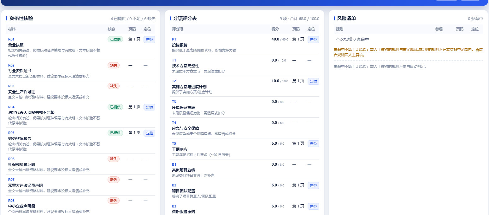
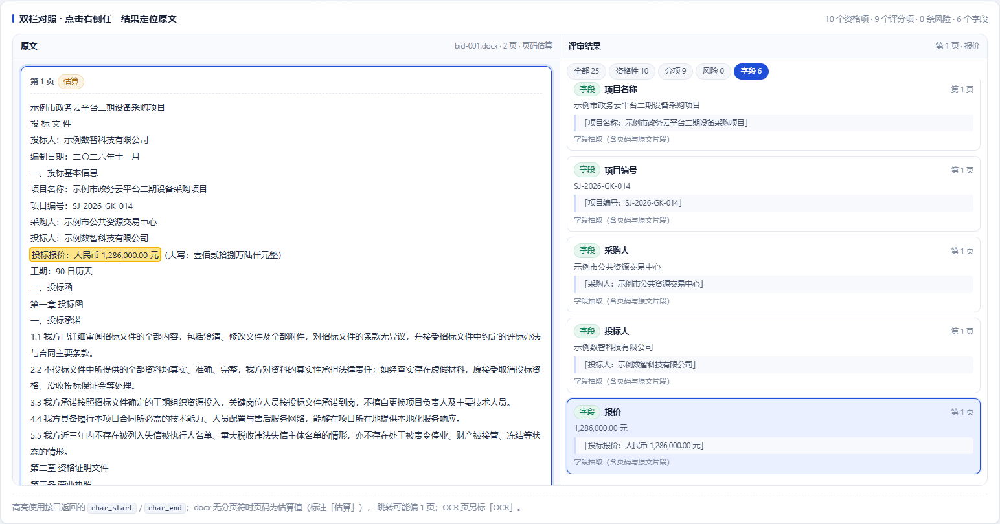
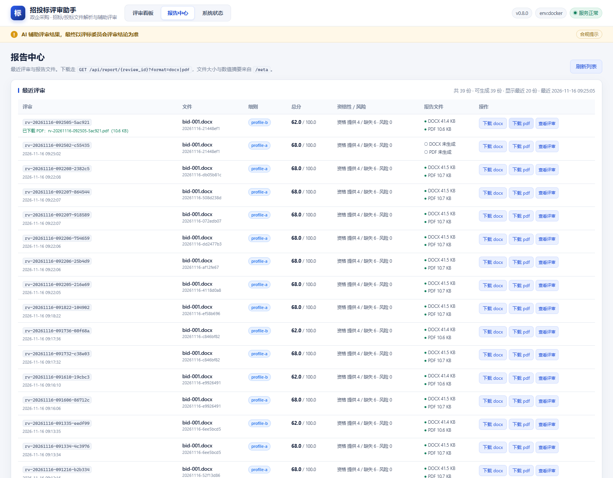

# 招投标评审助手 · 使用说明（面向评标专家与采购经办人）

> 版本：v0.9.0（D9）｜更新：2026-11-16。
> 本说明面向**使用页面做评审的人**；部署、API、MCP 与排错命令见 USAGE.md。
> **AI 辅助评审结果，最终以评标委员会评审结论为准**

---

## 零、5 分钟上手（最短路径）

1. 浏览器打开 **http://127.0.0.1:18080/#review**；
2. 「选择文件」里选一份，或一次选/拖入多个文件 →「上传并解析」；
3. 选 `profile-a` →「开始评审」；
4. 看「总分卡 + 资格性 + 分项 + 风险」；点表格「定位」回原文；
5. 左栏切「源文件」：PDF 看原文，docx 看 Word 渲染；
6. 进「报告中心」：点「预览」看评审摘要 + 报告 PDF；点「查看原件」并排比对；
7. 「系统状态」→ 管理员登录（本机演示 `admin` / `BidReview@2026`）→ 看自检、平台能力、数据管理。

> 管理员密码在 `.env` 的 `ADMIN_USER` / `ADMIN_PASSWORD`，部署前请改掉演示密码。

---

## 一、这份说明写给谁

| 角色 | 你会用它做什么 | 你得到什么 |
| --- | --- | --- |
| 评标专家 | 核对资格性材料、按细则看分项得分、抽查风险条款 | 总分卡 + 三张结果表 + 可点击回原文的证据 |
| 采购代理机构经办人 | 投标文件初审、整理澄清/补材料清单、导出审核报告 | 资格性缺失清单、扣分项、docx/pdf 报告 |
| 投标文件初审人员 | 快速定位“哪一页说了什么”，避免翻整本标书 | 双栏对照：左原文、右结果，一键跳页高亮 |
| 投标人 / 项目经理（内部自查） | 按同一套细则预演评分，提前发现缺项 | 分项得分、扣分理由、风险提示 |
| 不适用 | 证件真伪鉴定、业绩真实性核验、工程清单计价、法律意见 | 本工具只做文本核验与辅助评分，不出最终结论 |

> 一句话：**它是“帮你看得快、算得清、找得到原文”的辅助工具，不是评标委员会，也不出中标/废标结论。**

---

## 二、解决什么问题（需求）

| 实际痛点 | 本工具的做法 | 你能看到的结果 |
| --- | --- | --- |
| 标书几十上百页，翻页找依据慢 | 双栏对照：左栏按页渲染原文，右栏列证据 | 点“定位”自动跳到对应页并高亮原文 |
| 资格性材料“有没有、够不够”靠人记 | 按 R01–R10 做三态核验 | 已提供 / 效力不足 / 缺失，逐项带页码与原文 |
| 评分细则换项目就要重算 | 两套 YAML 细则可切换 | `profile-a` 68 分 / `profile-b` 62 分，分项差值可见 |
| 风险条款怕漏、又怕误报 | 40 条规则库 + 关键词/计算型扫描 | 命中项带等级、页码、原文、依据；未命中明确写“不等于无风险” |
| 评审完还要另写报告 | 报告中心直接导出 docx/pdf | 九章报告、双指纹、页脚免责声明与页码 |
| 复核时说不清“这个分怎么来的” | 每个分项、每条风险都带溯源 | 页码 + `quote` + 细则/规则指纹，可逐项复算 |

### 适用文件

- 格式：`docx` / `pdf` / `txt` / `md`；
- 大小：单文件 ≤ **50 MB**；
- 扫描件：走 OCR，单份 3 页约 **13–16 秒**（页面会显示进度与用时）；
- docx 无分页符时，页码按“每页约 38 行 × 38 字”估算，页面会标「估算」，跳转允许偏 1 页。

---

## 三、使用前准备

1. 浏览器打开服务地址：
   - 本机演示：**http://127.0.0.1:18080/#review**
   - 其他环境按部署文档的地址（默认 8080，但本机 8080 被 32 题占用，必须用 18080）；
2. 确认服务正常：右上角显示 `服务正常`；管理员登录「系统状态」后可看 6 项自检全绿；
3. 准备文件：建议先用 `data/samples/bid-001.docx` 走一遍；
4. 数据合规：演示样本均为虚构；上传件只落在本机 `data/`，不访问外网。

> 如果你看到「上传失败：网络错误」，通常不是服务挂了，而是页面不是从 `18080` 打开的
> （例如 `file://`、DSH 文件预览或其他端口）。用上面的地址重开并 Ctrl+F5。

---

## 四、操作步骤

### 4.1 认识界面

顶部三个入口：

- **评审看板**：上传/选文件 → 选细则 → 评审 → 看结果；
- **报告中心**：最近评审、预览/下载 docx/pdf、管理员数据管理；
- **系统状态**：管理员登录后看服务自检、平台能力、里程碑、交付物。

顶部黄色横条是固定免责声明，任何页面都在：
**AI 辅助评审结果，最终以评标委员会评审结论为准**

### 4.2 选择文件

两种方式，任选其一：

1. **选已解析文档**：在「已解析文档」下拉框选一份（显示文件名、页数、解析状态）；
2. **上传新文件（可多选）**：
   - 点「选择文件（可多选）」→ 在系统文件框里用 Ctrl/Shift 或鼠标拉框选多个文件；
   - 也可以把资源管理器里拉框选中的多个文件，直接拖到上传区；
   - 选多个后按钮显示「上传并解析 (N)」，逐份上传/解析，完成后显示成功/失败汇总并选中最后一份成功文档。

上传后的提示：

- 解析完成：显示页数、字段 6/6、是否 OCR；
- 解析失败：显示失败原因，该文档不能进入评审；
- `degraded`：内部状态（页码估算或含 OCR 页），**不是解析失败**；评审看板不显示该标签，报告内会注明页码口径；
- 扫描件：进度条先到 100%，再显示“服务端正在解析”，请等计时结束。

> 评审看板不显示「降级」标签；OCR / 页码估算在报告内注明页码口径。

### 4.3 选择评分细则

在「选择评分细则」卡片里选一套：

| 细则 | 权重 | 适用场景 |
| --- | --- | --- |
| `profile-a` 综合评分法 | 价格 40 / 技术 40 / 商务 20 | 常规货物/服务项目 |
| `profile-b` 技术优先型 | 价格 30 / 技术 50 / 商务 20 | 技术权重更高的项目 |

卡片上会显示：最高限价、工期要求、9 项、总分 100、细则指纹。
切换细则只改选择，不会自动重评。

### 4.4 开始评审

点「开始评审」：

- 页面显示“正在核验资格性、计算分项得分并扫描风险”，按钮禁用并计时；
- 正常约 0.1–1 秒完成；扫描件在**上传阶段**耗时，评审本身很快；
- 成功后结果区出现「总分卡 + 资格性表 + 分项表 + 风险清单 + 双栏对照」。

### 4.5 看总分卡

总分卡从左到右：

- **总分 / 满分**：当前细则下的合计；
- **资格性**：`已提供/缺失`（如 4/6），下面写“缺失、效力不足、共 10 项”；
- **风险命中**：条数 + 高/中/低分布；
- **细则对比**：切换细则重评后显示差值（如 −6.0）；
- 底部：评审编号、细则指纹、规则指纹、页码口径；右侧可「导出 docx / 导出 pdf」。

### 4.6 看三张结果表

| 表 | 看什么 | 怎么用 |
| --- | --- | --- |
| 资格性核验 | 10 项材料的三态、页码、原文 | 缺失项用于发澄清/补材料通知 |
| 分项评分表 | 9 项得分/满分、理由、页码 | 看扣分点；换细则后每行有“较上次”差值 |
| 风险清单 | 命中项等级、规则、页码、原文 | 点“定位”回原文；0 条时看下方人工核对提示 |

> 表格每一行的“定位”按钮都会联动左栏原文；没有原文的缺失项不显示定位。

### 4.7 双栏对照（最常用）

结果区下方的「双栏对照」：

- **左栏**：顶部「解析文本 / 源文件」两个标签；
  - 解析文本：按 `pages[]` 渲染，页头标「第 N 页」「估算」「OCR」；
  - 源文件：PDF/txt/md 直接内嵌原件；docx 用服务端 Word HTML 渲染（近似版式）；
- **右栏**：全部 / 资格性 / 分项 / 风险 / 字段 五个标签；
- 点右栏任一条，或点表格里的「定位」：
  - 左栏自动切回「解析文本」并滚到对应页；
  - 原文片段用黄色 `<mark>` 高亮；
  - 右栏该条变蓝，顶部显示“第 N 页 · 条目名”；
- 缺失项没有原文时，提示“该条结果没有可定位的原文”。

### 4.8 换细则重评

1. 在细则卡片切到另一套（如 `profile-b`）；
2. 按钮会变成「用 profile-b 重新评审」；
3. 点它，结果区会显示：
   - 总分对比：`profile-a 68.0 → profile-b 62.0（−6.0）`；
   - 分项表每行“较 profile-a：40.0 → 30.0 分”和 `−10.0` 徽标；
   - 保留当前结果，不覆盖上一份，便于对照。

### 4.9 报告中心

点顶部「报告中心」：

- 列出最近评审（默认最近 20 份）；
- 每行显示：评审号/时间、文件、细则、总分、资格性/风险、报告文件大小；
- 行内按钮：
  - **预览**：上方显示评审摘要，下方内嵌报告 PDF；右上「查看原件」展开为左原件、右报告并排，再点「收起原件」恢复单栏；
  - **下载 docx / 下载 pdf**：真实下载；未生成时会即时生成；
  - **查看评审**：回到评审看板，打开该次结果；
- 右上角「刷新列表」；
- 文档已不存在的历史评审默认隐藏，可点「显示 N 份不可用记录」切换。

报告是幂等的：同一评审重复下载返回同一文件；改数据后要重新评审再导出。

### 4.10 系统状态（管理员）

点顶部「系统状态」会先出现**管理员登录**：

- 账号密码由部署人在 `.env` 的 `ADMIN_USER` / `ADMIN_PASSWORD` 配置；本机演示为 `admin` / `BidReview@2026`，部署前请改；
- 登录成功后才显示服务自检、运行信息、平台能力、里程碑与交付物；数据管理在「报告中心」底部；
- 右上角「退出管理员」可立即退出；会话默认 8 小时。

登录后可以看到：

- 服务自检 6 项（含免责声明逐字比对）；
- 平台能力：MCP 显示「**已接入 8 个工具**」、知识库「已就绪」、Skill「已挂载 4 个」；
- 「项目能力总览（D1–D9）」：解析、OCR、40 条规则、两套细则、风险、报告、看板、Skill 与评测；
- 「报告中心 → 数据管理」：文档/评审/报告数量，支持删除与批量清理（见 4.11）。

### 4.11 数据管理（删除文件与报告）

登录后进入「报告中心」，页面底部「数据管理」：

| 操作 | 作用 | 注意 |
| --- | --- | --- |
| 筛选框 | 按文件名 / `doc_id` / 评审号过滤两张表 | 只影响显示，不删数据 |
| 勾选 / 表头全选 | 选中多份后点「删除所选文档 / 删除所选评审」 | 只对当前筛选可见行批量操作 |
| 文档「预览」 | PDF 内嵌原文；docx 用 Word HTML 渲染；txt/md 内嵌原文 | Word 渲染是近似版式，复杂表格以原件为准 |
| 文档「保存」 | 下载上传原件 | 浏览器下载 |
| 文档「删除」 | 删除解析 JSON + 上传原件，并**级联删除**其评审与报告 | 不可恢复 |
| 评审「预览」 | 弹窗上方评审摘要，下方内嵌报告 PDF；可展开原件并排 | 不需要先下载 |
| 评审「删报告」 | 只删该次评审的 docx/pdf | 评审保留，可重新生成 |
| 评审「删评审」 | 删除评审 JSON + 其报告 | 不可恢复 |
| 「清理重复文档」 | 按文件名分组，每组只保留最新 1 份，删除其余文档及其评审/报告 | 不可恢复，先确认 |
| 「清理无文档评审」 | 删除对应文档已不存在的评审与报告 | 用于清理历史残留 |

所有删除都有二次确认；操作完成后列表和报告中心会刷新。

> 建议：演示前先点「清理重复文档」，可把测试产生的同名副本收拢到每种一份。

---

## 五、你会得到什么结果

### 5.1 样例：`bid-001.docx` + `profile-a`

| 结果项 | 实际值 |
| --- | --- |
| 总分 / 满分 | **68.0 / 100** |
| 分类小计 | 价格 40/40、技术 16/40、商务 12/20 |
| 资格性 | **已提供 4 / 效力不足 0 / 缺失 6**（R02、R03、R06、R08、R09、R10；阶段 2 后 R07 已提供） |
| 风险 | **0 条命中**（扫描 27 条：18 关键词 + 9 计算型；另有 10 条人工核对、3 条未实现） |
| 细则指纹 / 规则指纹 | `fd898ab727cf8c12` / `188bf9a7ff58f159` |
| 页码口径 | 2 页，docx 无分页符 → **估算（可能偏 1 页）** |

分项：

| 项 | 得分/满分 | 说明 |
| --- | ---: | --- |
| P1 投标报价 | 40/40 | 报价 1,286,000 元，低于最高限价 90% |
| T1 技术方案 | 0/10 | 未见技术方案章节 |
| T2 实施方案 | 10/10 | 检出“实施计划” |
| T3 质量保证 | 0/8 | 未见质量保证措施 |
| T4 应急安全 | 0/6 | 未见应急/安全保障措施 |
| T5 工期响应 | 6/6 | 90 日历天，满足要求 |
| B1 类似业绩 | 0/8 | 未见类似项目业绩 |
| B2 项目团队 | 6/6 | 检出“项目负责人” |
| B3 售后服务 | 6/6 | 检出“售后服务” |

### 5.2 换 `profile-b` 后

| 项 | profile-a | profile-b | 差值 |
| --- | ---: | ---: | ---: |
| P1 投标报价 | 40.0 / 40 | 30.0 / 30 | −10.0 |
| T2 实施方案 | 10.0 / 10 | 12.0 / 12 | +2.0 |
| T5 工期响应 | 6.0 / 6 | 8.0 / 8 | +2.0 |
| **总分** | **68.0** | **62.0** | **−6.0** |

### 5.3 双栏对照效果

- 点“报价”字段：左栏第 1 页高亮「投标报价：人民币 1,286,000.00 元」；
- 点风险 R12（risk-001 样本）：左栏第 1 页高亮超限价原文。

### 5.4 报告内容

导出文件：

- `rv-<评审号>.docx`：九章结构，页脚含免责声明 + 页码；
- `rv-<评审号>.pdf`：3 页左右，中文正常，页脚同样含免责声明 + 页码；
- 报告数值 = 页面数值（`check_report.py` 可复算）。

九章：封面与文档信息 / 评审依据与口径 / 项目与投标人 / 资格性核验 / 分项评分 / 风险清单 /
合同摘要 / 结论与建议 / 免责声明。

### 5.5 结果怎么读、不能怎么读

| 可以这样读 | 不要这样读 |
| --- | --- |
| “资格性缺失 6 项，建议要求澄清/补材料” | “资格审查不通过 / 废标” |
| “风险命中 0 条，但仍有 10 条需人工核对” | “没有风险” |
| “docx 第 1 页（估算）” | “绝对第 1 页” |
| “依据状态 pending → 未检索到权威依据” | 自行补法条、文号 |
| “AI 辅助结果，供评委参考” | “评标委员会最终结论” |

---

## 六、常见问题

| 现象 | 原因 | 处理 |
| --- | --- | --- |
| 页面能开、上传网络错误 / 文档列表为空 | 页面不是从 18080 打开（file://、预览、其他端口） | 用 `http://127.0.0.1:18080/#review`，Ctrl+F5 |
| 上传 413 | 超过 50 MB | 压缩/拆分；或调 `MAX_UPLOAD_MB` |
| 上传 415 | 文件类型不支持 | 只支持 docx / pdf / txt / md |
| 扫描件等很久 | OCR 正常耗时 13–16 秒 | 等进度条与计时，不要重复点 |
| 评审 404 | 文档不存在/被清理 | 重新上传再评审 |
| 报告 404 | 报告未生成或文档丢失 | 先评审再导出；确认评审还在 |
| 源文件/预览提示“只有解析结果” | 该文档没有上传原件（历史/测试数据） | 换一份新上传的文档，或看解析文本 |
| Word 渲染和 Word 打开不完全一样 | 浏览器里是 HTML 近似渲染 | 需要原版式时到数据管理保存原件 |
| 依据全是“未检索到权威依据” | 知识库索引名不匹配 | 按 D4/D7 交接检查 `index_names` |
| 报告里写“页码来源：估算 / 精确” | docx 无分页符 / 扫描件 OCR | 不是失败；页码为估算，核对原件 |
| 报告下载后打不开 | 文件未下载完整 / 阅读器限制 | 重新下载；PDF 用支持中文的阅读器 |

---

## 七、边界与限制

1. 只覆盖货物/服务/工程三类招标的**投标文件侧**，不判断证件真伪、不核验业绩真实性；
2. 25 份样本为自造合成数据，100%/0% 的成绩不代表真实业务泛化；
3. 自动规则 27 条（18 关键词 + 9 计算型）；10 条需人工核对，3 条暂未实现（R25/R32/R33 需多家比价）；
4. docx 无分页符时页码为估算，跳转允许偏 1 页；
5. 双栏默认显示解析文本；「源文件」标签的 docx 为 HTML 近似渲染，复杂表格/分页以原件为准；
6. 报告幂等但没有自动失效，改数据需换新评审；
7. 主页面为单机演示；系统状态/数据管理有管理员密码门禁（演示级，不是多用户权限系统），
   上传件与报告落盘在 `data/`（已 gitignore）；
8. 不输出中标/废标结论；最终以评标委员会评审结论为准；
9. 历史/测试数据可能只有解析结果、没有上传原件；此时源文件/预览会提示，只能查看解析文本。

---

## 八、一页速查

| 我想…… | 点哪里 | 结果 |
| --- | --- | --- |
| 换一份文件 | 评审看板 → 选择文件 / 上传并解析 | 文档进入下拉框 |
| 换一套细则 | 细则卡片 → `profile-a` / `profile-b` | 按钮变“用 xx 重新评审” |
| 重新算分 | 开始评审 / 重新评审 | 总分卡与三表刷新 |
| 看某条依据 | 表格“定位”或右栏证据 | 左栏跳页并高亮 |
| 看源文件 | 左栏「源文件」标签 | PDF 原文 / Word HTML 渲染 |
| 看评审与报告 | 报告中心 →「预览」 | 摘要 + 报告 PDF；「查看原件」并排 |
| 登录管理员 | 系统状态 → 管理员登录 | 自检、平台、数据管理 |
| 只看资格性 | 右栏「资格性」标签 | 10 项三态 |
| 只看风险 | 右栏「风险」标签 | 命中项 + 边界提示 |
| 下载报告 | 报告中心 → 下载 docx/pdf | 文件保存到本地 |
| 回看某次评审 | 报告中心 → 查看评审 | 回到结果页 |
| 确认服务正常 | 系统状态 → 重新自检 | 6 项全绿 |

---

## 九、术语

| 术语 | 含义 |
| --- | --- |
| `doc_id` | 上传后生成的文档编号，形如 `20261116-d74d0cbf` |
| `review_id` | 一次评审的编号，形如 `rv-20261116-092505-5ac921` |
| `profile-a/b` | 两套评分细则的 ID |
| 细则指纹 | 评分细则内容的哈希，用于回溯“用哪套口径算的” |
| 规则指纹 | 40 条规则库的哈希，用于回溯规则版本 |
| `degraded` | 降级：页码估算或 OCR，不是解析失败 |
| `page_source` | `native` 精确分页 / `estimated` 估算 / `single` 单页 |
| `basis_status` | `verified` 已核依据 / `pending` 未检索到 / `na` 经验判据 |
| 三态 | 已提供 / 效力不足 / 缺失 |

---

## 十、技术参考

- 部署与排错：`DEPLOY.md`、`USAGE.md`
- 接口与 MCP：`USAGE.md` 第三、四节；`/api/docs`
- 测试报告：`docs/TEST_REPORT.md`
- 留出集成绩：`docs/留出集单独成绩.md`
- 交接文档：`docs/D9-交接文档.md` / `.docx`
- 页面截图：`docs/screenshots/`

> 再次提示：**AI 辅助评审结果，最终以评标委员会评审结论为准**
