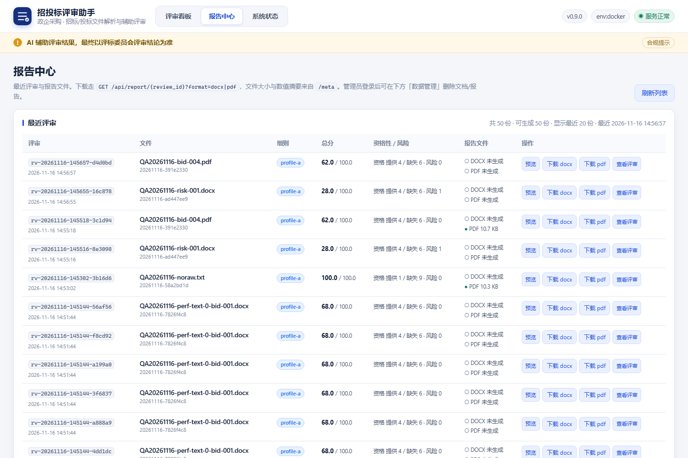

# 评审说明（评测结论）

> 本文件是**对外的一份评测说明**：只采用第二批新样本（N01–N10）的评分结果。
> 第一批样本（S01–S10）的评分参数不准确、且与判据修订过程混在一起，**不再作为依据**，相关材料已从仓库移除。
> 复算：`python tools\eval_calibrated.py --strict`（退出码 0 即通过）。

## 一、评测对象

| 项 | 内容 |
| --- | --- |
| 系统 | 招投标评审助手（文档解析 → 资格性核验 → 9 项评分 → 风险扫描 → 报告） |
| 样本 | 第二批 10 份匿名投标文件（N01–N10，虚构数据，每份 2 页） |
| 细则 | 9 项 100 分：P1 报价 40、T1–T4 技术 40、T5 工期 6、B1–B3 商务 20 |
| 参数 | 最高投标限价 2,000,000.00 元；工期要求 90 日历天 |
| 参考评分 | 评审人按同一细则盲评，评分表与意见书存 `docs/评审功能测评数据/01-评分重评/` |

样本结构：N01/N04/N05/N09 各项有实质内容；N02/N06/N08 的 T2/B2/B3 只有“本章节仅列标题”；
N03 是三处套话；N07 缺售后承诺；N08 报价超限价；N10 缺技术方案与应急章节、报价落在 0.97–1.00 档。

## 二、评分口径

只在“有没有实质内容”上判定，不看是否出现关键词：

- **T1–T4、B1–B3**：给出可核查的内容才给满分；只写节标题、“仅列标题”“未展开/未提供”，或只有表态句（“将按工期安排组织施工”“响应时限短”）一律 0 分；
- **B3**：须给出响应/解决时限、SLA 或质保期之一；只写“7×24 小时受理/响应”这种服务时段记 0；
- **P1**：投标报价 ÷ 2,000,000 对档（≤0.90=40；≤0.97=36；≤1.00=28；>1.00=0）；
- **T5**：≤90 天=6；91–108 天=4；>108 天=0。

## 三、结果

| 样本 | 参考评分 | 旧引擎 `profile-a` | 偏差 | 校准引擎 `profile-a-calibrated` | 偏差 |
| --- | ---: | ---: | ---: | ---: | ---: |
| N01 | 100 | 100 | 0 | 100 | 0 |
| N02 | 72 | 94 | +22 | 72 | 0 |
| N03 | 78 | 100 | +22 | 78 | 0 |
| N04 | 100 | 100 | 0 | 100 | 0 |
| N05 | 100 | 100 | 0 | 100 | 0 |
| N06 | 78 | 100 | +22 | 78 | 0 |
| N07 | 94 | 100 | +6 | 94 | 0 |
| N08 | 32 | 54 | +22 | 32 | 0 |
| N09 | 100 | 100 | 0 | 100 | 0 |
| N10 | 44 | 66 | +22 | 44 | 0 |

| 指标 | 旧引擎 | 校准引擎 |
| --- | ---: | ---: |
| ±5 内 | **4/10（40%）** | **10/10（100%）** |
| 平均绝对偏差 | **11.60 分** | **0.00 分** |


## 四、偏差从哪来

旧引擎的偏差全部同向（引擎高、参考低），且只集中在三项：

| 项 | 旧引擎判据 | 问题 | 出现样本 |
| --- | --- | --- | --- |
| T2 实施方案 | 命中「实施计划」给 10 | 标题或套话即算响应 | N02 N03 N06 N08 N10 |
| B2 项目团队 | 命中「项目负责人」给 6 | 投标函一句表态即算配置 | N02 N03 N06 N08 N10 |
| B3 售后 | 命中「售后服务」给 6 | 服务时段≠可考核承诺 | N02 N06 N07 N08 N10 |

价格与工期两项没有误判。**结论：不是算错，是 presence 判据太粗。**

## 五、判据改了什么

新增 `data/scoring/profile-a-calibrated.yaml`（旧 `profile-a` 原样保留作基线），只改 T2/B2/B3：

1. 用 `content_patterns` 代替关键词：T2 认「里程碑/横道图/关键路径/节点/进度安排/工期安排/进度控制」，B2 认「项目管理机构/人员配置表/人员表/项目团队表/职称证书/注册建造师/建造师证书/项目经理证书」，B3 认「小时内响应/小时响应/小时到场/SLA/服务级别/响应时限/解决时限」；
2. `content_number_patterns`：T2 的「节点/进度安排/工期安排」、B3 的「响应时限/解决时限」必须与**数字＋时间单位**同现，挡住“按工期安排组织施工”这类套话；
3. **负向句**：命中句里出现「未提供/未展开/仅列标题/没有」时判未提供，避免“未提供项目管理机构及人员表”被当成已提供。

系统默认细则已切到校准版（`/api/review` 与 `api/review/service.py`）。

## 六、样本本身的问题（已处理）

| 问题 | 处理 |
| --- | --- |
| N02–N08 的「报价明细」三行恒为 118 万，与各自投标报价矛盾（N08 若按明细，P1 会从 0 变 40） | 已按各自报价重算三项，与投标函一致；只改示意明细，评分不变；N09/N10 生成时即为正确口径 |
| N01–N08 的 T1/T3/T4 文本相同，恒为 24 分，对这 8 份没有区分力 | 不改已评样本（会破坏参考分）；N09/N10 已让 T1/T4 出现“有/无”对照；下一批继续扩展 |
| 工期 >108 天与“完全没写工期”同为 0 分 | 这是细则设定（超 20% 视为实质性偏离），不动分数；报告中按“响应但超期”“未提供”分别描述 |
| 价格档几乎都落在 40 分档 | 仅在 N08（超限价 0）、N10（0.975→28）出现非满档，属样本报价分布问题，不影响判据 |

## 七、局限（与成绩一起看）

1. **n=10**：10/10 的 95% 置信区间约 72%–100%，只能写“本批 10 份全部一致”，不宜写成“稳定达到 85%”；
2. **合成样本**：由同一套模板生成，句式、结构比真实标书规整，真实标书的長篇叙述与附件表格尚未覆盖；
3. **单评审人**：只有一份参考评分，没有第二人复核，因此是“与一名评审人一致”，不是“专家一致性”；
4. **判据是在上一批样本上定的**：本批未参与调参，属 out-of-sample；但两批同源，同源偏差需承认。

## 八、其它评测（简要）

| 项目 | 结果 | 位置 |
| --- | --- | --- |
| 解析/字段 | 25 份样本、146 个字段的准确率 | `data/samples/manifest.json`、`tools/eval_parse.py` |
| 风险扫描 | 15 份植入 + 5 份干净对照，TP/FN/FP | `tools/eval_risks.py` |
| 规则覆盖 | 40 = 自动 27 + 人工 10 + 未实现 3 | `tools/eval_rule_coverage.py` |
| 资格性 | 25 份 × 10 = 250 条三态标注 | `docs/评审功能测评数据/02-资格性标注/组织者用/一致性报告.md` |
| 报告一致性 | 报告数值与页面数值逐项比对 | `tools/check_report.py` |

## 九、复算与留痕

```powershell
python tools\eval_calibrated.py --strict     # 10/10、平均偏差 0.00
python tools\validate_rules.py               # 规则库 40 条、30 verified / 6 pending / 4 na
python -m pytest tests -q                    # 66 passed / 1 skipped
```

原始材料（不可再生）：

- 参考评分：`docs/评审功能测评数据/01-评分重评/评分表_N01-N10.xlsx`、`评分意见_N01-N10.docx`；
- 回归集：`data/samples/out_of_sample/manifest.json`（含逐项分与每份样本的设计意图）；
- 发给评审人的盲评包已归档在 `docs/评审功能测评数据/`；不作为结论依据。


